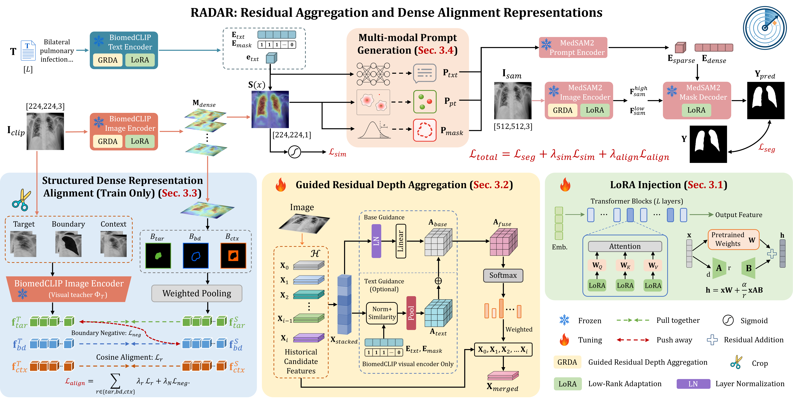
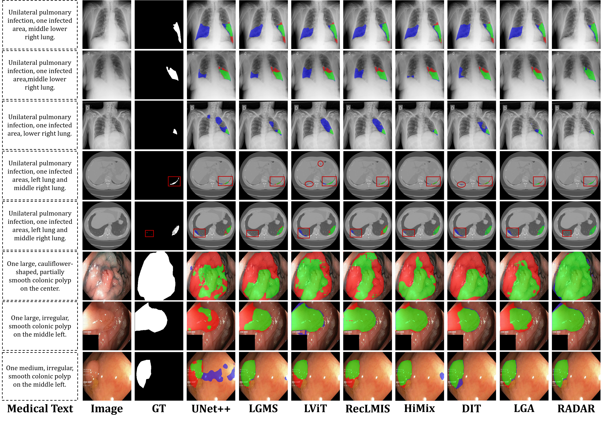

<div align="center">

# Text-Guided Medical Image Segmentation via Residual Aggregation and Dense Alignment Representations

**🎉 Accepted by NeurIPS 2026**

<p>
  <a href="https://arxiv.org/abs/xxxx.xxxx"><strong>📄 Paper</strong></a>
  &nbsp;•&nbsp;
  <a href="https://github.com/JGuiidev/RADAR"><strong>💻 Code</strong></a>
</p>

<p>
  <a href="https://arxiv.org/abs/xxxx.xxxx"></a>
  <a href="https://neurips.cc/"></a>
  <a href="https://www.python.org/"></a>
  <a href="https://pytorch.org/"></a>
</p>

RADAR is a parameter-efficient framework that connects BiomedCLIP and MedSAM2 for text-guided medical image segmentation.

</div>

> **News — September 2026:** RADAR was accepted by NeurIPS 2026.

---

## 🔥 Highlights

- **Parameter-efficient cross-foundation adaptation:** RADAR connects the complementary semantic knowledge of BiomedCLIP with the segmentation capability of MedSAM2 while keeping the pretrained backbones frozen and adapting them with lightweight LoRA modules.
- **GRDA:** Guided Residual Depth Aggregation dynamically aggregates historical representations across network depth, using language semantics to guide visual feature selection and preserve task-relevant information throughout encoding.
- **SDRA:** Structured Dense Representation Alignment aligns dense visual representations with a frozen BiomedCLIP teacher over target, boundary, and contextual regions, while explicitly discouraging boundary features from collapsing toward target semantics.
- **MPG:** Multi-modal Prompt Generation converts global text semantics and dense image-text similarity into complementary text, point, and mask prompts that can be directly consumed by MedSAM2.

---

## 🧠 Method Overview

<p align="center">
  
</p>
<p align="center">
  <sub>RADAR bridges BiomedCLIP and MedSAM2 through depth-aware representation aggregation, structured dense alignment, and multi-modal prompt generation.</sub>
</p>

| Component | Role |
|---|---|
| **GRDA** | Aggregates intermediate representations across depth through adaptive routing, with language-guided visual aggregation to retain semantically relevant information during encoding. |
| **SDRA** | Aligns projected dense student representations with frozen BiomedCLIP teacher features over target, boundary, and context regions, together with boundary-negative rejection for improved structural discrimination. |
| **MPG** | Transforms global text features and image-text similarity responses into a text prompt, positive/negative point prompts, and a dense mask prompt for MedSAM2. |

## 📊 Main Results

| Dataset | Dice | mIoU | HD95 | ASSD |
|---|---:|---:|---:|---:|
| QaTa-COV19 | 84.12 | 75.32 | 14.27 | 4.09 |
| MosMedData+ | 75.47 | 62.43 | 13.16 | 3.26 |
| Kvasir | 92.15 | 86.65 | 14.79 | 3.91 |

---

## 👀 Qualitative Results

<p align="center">
  
</p>
<p align="center"><sub>Representative segmentation results across the evaluated datasets.</sub></p>

---

## 🛠️ Requirements

| Requirement | Version |
|---|---|
| Python | 3.10+ |
| PyTorch | 2.9.0 |
| TorchVision | 0.24.0 |
| CUDA | 12.8 |

```bash
conda create -n radar python=3.10 -y
conda activate radar
python -m pip install torch==2.9.0 torchvision==0.24.0 --index-url https://download.pytorch.org/whl/cu128
python -m pip install -r requirements.txt
```

---

## 📂 Dataset Organization

Place each supported dataset under `data/` using the same split layout:

```text
data/
└── <dataset>/
    ├── Train_Folder/
    │   ├── images/
    │   ├── masks/
    │   └── Train_text.xlsx
    ├── Val_Folder/
    │   ├── images/
    │   ├── masks/
    │   └── Val_text.xlsx
    └── Test_Folder/
        ├── images/
        ├── masks/
        └── Test_text.xlsx
```

| Dataset directory | Preflight command |
|---|---|
| `data/QaTa-COV19/` | `python tools/check_dataset.py data/QaTa-COV19` |
| `data/MosMedData+/` | `python tools/check_dataset.py data/MosMedData+` |
| `data/Kvasir/` | `python tools/check_dataset.py data/Kvasir` |

Each spreadsheet must contain `Image` and `Description` columns. Mask filenames may match image filenames or use the `mask_` prefix. The preflight checks split structure, file integrity, image-mask pairing, duplicates, and annotations.

---

## 🚀 Training

The default Full RADAR command uses QaTa-COV19, `cuda:0`, and batch size 8:

```bash
python train_model.py --dataset QaTa-COV19 --device cuda:0 --batch-size 8
```

Dataset-specific launchers forward any additional CLI arguments:

```bash
bash scripts/train_qata.sh
bash scripts/train_mosmed.sh
bash scripts/train_kvasir.sh
```

Resume an interrupted run from its training-state checkpoint:

```bash
python train_model.py --dataset QaTa-COV19 --resume checkpoints/QaTa-COV19/last_checkpoint.pth
```

<details>
<summary><strong>Checkpoint roles</strong></summary>

| File | Purpose |
|---|---|
| `best_checkpoint.pth` | Trainable parameters and the model reconstruction settings used for evaluation. |
| `last_checkpoint.pth` | Optimizer, scheduler, scaler, epoch, metric, and training state used for resumption. |

</details>

---

## 🧪 Evaluation

Evaluate an explicit best checkpoint:

```bash
python eval_model.py --dataset QaTa-COV19 --checkpoint checkpoints/QaTa-COV19/best_checkpoint.pth
```

The dataset launchers use `checkpoints/<dataset>/best_checkpoint.pth` by default:

```bash
bash scripts/test_qata.sh
bash scripts/test_mosmed.sh
bash scripts/test_kvasir.sh
```

Add `--save-predictions` to write binary masks under `outputs/<dataset>/`. During inference, RADAR receives only images and text; masks are used after prediction for metric computation.

---

## ♻️ Reproduction

| Setting | Full RADAR default |
|---|---|
| Dataset | QaTa-COV19 |
| Device | `cuda:0` |
| Batch size | 8 |
| DataLoader workers | 4 |
| Epochs | 500 |
| Learning rate | `3e-4` |
| Early-stopping patience | 50 |

Recommended workflow:

1. Run the dataset preflight.
2. Train with the dataset-specific launcher or the explicit Full RADAR command.
3. Evaluate `best_checkpoint.pth` with the matching dataset name.
4. Run the profiler separately when reporting model complexity.

---

## 📈 Model Complexity

Run the profiler at batch size one:

```bash
python tools/profile_model.py --dataset QaTa-COV19 --device cuda:0
```

---

## 📖 Citation

```bibtex
@inproceedings{gui2026radar,
  title     = {Text-Guided Medical Image Segmentation via Residual Aggregation and Dense Alignment Representations},
  author    = {Gui, Jie and Tu, Hang and Dou, Yunfeng and Sha, Wen and Du, Xiuquan and Li, Shuo},
  booktitle = {Advances in Neural Information Processing Systems},
  year      = {2026}
}
```
